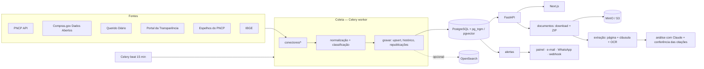

# Arquitetura

## Módulos (`backend/licitacoes/`)

| Arquivo | Papel |
|---|---|
| `config.py` | Configuração por variáveis `LIC_*` |
| `db.py`, `modelos.py` | Banco e tabelas (SQLAlchemy 2) |
| `conectores/base.py` | HTTP com ritmo mínimo, esperas no 429, novas tentativas em 5xx/rede, sem contornar 401/403 |
| `conectores/pncp.py`, `conectores/outras.py` | Um conector por fonte e a normalização para o esquema único |
| `catalogo.py` | Lista de portais, status de integração e identificação da plataforma de disputa |
| `coleta.py` | Gravação (upsert por número de controle do PNCP), prioridade entre fontes, histórico, republicações, rotinas de sincronização, conferência individual |
| `taxonomia.py` | Categorias, termos, exclusões, termos ambíguos com contexto, expansão da consulta |
| `busca.py` | Filtros estruturados + expansão por significado |
| `indexacao.py` | OpenSearch e embeddings (pgvector), opcionais |
| `documentos.py`, `armazenamento.py` | Classificação dos anexos, download, ZIP com manifesto; disco local ou S3 |
| `extracao.py` | Texto por página e cláusula; reaproveita o `restaurador/` do repositório (OCR, PDF danificado, acentos) |
| `analise.py` | Relatório com o Claude: saída estruturada (JSON Schema), citações conferidas no texto, natureza de cada dado |
| `precificacao.py` | Preço por divisor (BDI), simulações, Excel com fórmulas e PDF |
| `alertas.py` | Eventos, chave única por alerta, canais de entrega |
| `painel.py` | Números do painel e do controle de qualidade |
| `auth.py` | JWT, papéis (admin, analista, leitor), PBKDF2 |
| `tarefas.py` | Celery (fila e agenda) e o ciclo sem Celery |
| `api.py`, `cli.py` | API HTTP e linha de comando |

## Banco

`licitacao` é a tabela central. A chave é `pncp:<número de controle>` quando o edital está no PNCP, então
o mesmo edital vindo do PNCP, do Compras.gov ou de um espelho vira um registro só (`fontes_vistas` mostra
todas). Outras tabelas: `item`, `documento`, `analise`, `historico_alteracao` (prazo, situação, valor, objeto,
documento novo, exclusão), `sincronizacao` (cada execução de cada fonte), `fonte`, `orgao`, `municipio`,
`monitoramento`, `alerta` (com `chave_dedupe` única), `proposta`, `categoria`, `favorito`, `usuario`, `log_auditoria`.

Índices de busca: trigram (`pg_trgm`) sobre `texto_busca`, que é o objeto, o órgão e o município sem acento
e em minúsculas. Com pgvector instalado, `licitacao_embedding` guarda vetores de 384 dimensões.

## Decisões

* **Fonte oficial vence espelho.** Espelho só preenche campo vazio; o PNCP sobrescreve.
* **Nada inventado.** Valor zero vira "sem valor divulgado"; documento que não baixa fica listado com o motivo;
  a IA diz "não encontrado" quando não acha; cada citação é conferida no texto e marcada se não confere.
* **Três naturezas de informação** na análise e na proposta: oficial (dita pela fonte), cálculo (conta feita
  pela plataforma ou pela IA, com a conta descrita) e estimativa da IA (com a base).
* **IA:** modelo `claude-opus-5-5`, esforço `high`, saída estruturada por JSON Schema, cache do texto dos
  documentos (reanálise mais barata) e fallback do servidor em caso de recusa. Documento grande demais
  para o limite configurado: as páginas mais relevantes vão e as omitidas ficam listadas no relatório.
* **Ritmo das fontes acima da frequência desejada.** O ciclo de 15 minutos respeita os 4 s entre chamadas do
  PNCP; uma trava no Redis impede dois ciclos simultâneos.
