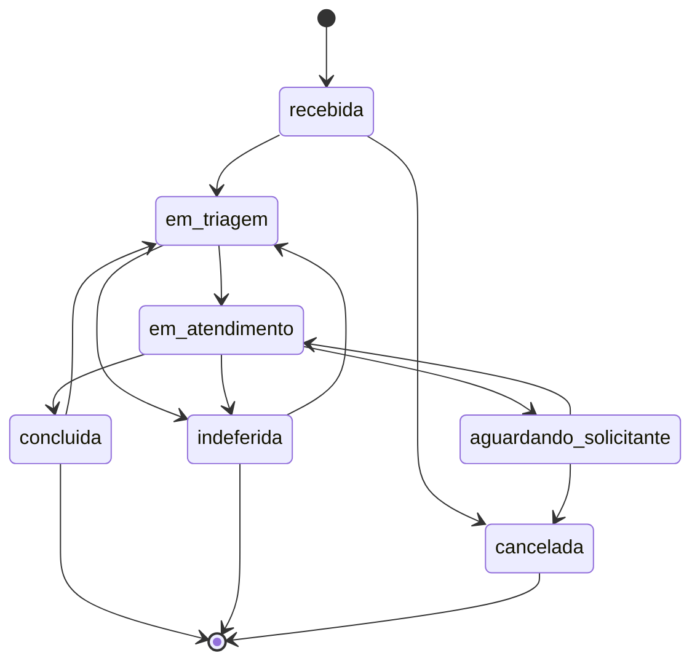

# Processo de tramitação das solicitações (REQ-003)

Modelagem do processo implementado em `solicitacoes/fluxo.py` (as tabelas abaixo são geradas a partir do código, então
documento e sistema não divergem). Fluxo proposto até a entrevista obrigatória confirmar estados e prazos reais do contratante.

## Estados

| Estado | Significado | Quem trabalha nele |
|---|---|---|
| Recebida | Solicitação aberta, ainda não analisada | Fila de triagem (operadores e gestor) |
| Em triagem | Conferência de categoria, completude e competência | Operador ou gestor |
| Em atendimento | Execução do pedido pelo responsável | Responsável atribuído |
| Aguardando solicitante | Atendimento parado à espera de complemento | Solicitante |
| Concluída | Pedido atendido, com resposta registrada | — (final) |
| Indeferida | Pedido recusado, com motivo registrado | — (final) |
| Cancelada | Desistência do solicitante, com motivo | — (final) |

Arquivamento é uma marca separada do estado: só o gestor arquiva, só solicitações finalizadas, e arquivada não tramita até ser desarquivada.

## Diagrama

## Transições permitidas

| De | Para | Perfis | Exigências |
|---|---|---|---|
| Recebida | Em triagem | gestor, operador | — |
| Recebida | Cancelada | solicitante | comentário obrigatório (motivo, pedido ou resposta); solicitante só na própria |
| Em triagem | Em atendimento | gestor, operador | responsável atribuído; operador só se for o responsável |
| Em triagem | Indeferida | gestor, operador | comentário obrigatório (motivo, pedido ou resposta) |
| Em atendimento | Aguardando solicitante | gestor, operador | comentário obrigatório (motivo, pedido ou resposta); operador só se for o responsável |
| Em atendimento | Concluída | gestor, operador | comentário obrigatório (motivo, pedido ou resposta); operador só se for o responsável |
| Em atendimento | Indeferida | gestor, operador | comentário obrigatório (motivo, pedido ou resposta); operador só se for o responsável |
| Aguardando solicitante | Em atendimento | gestor, operador, solicitante | comentário obrigatório (motivo, pedido ou resposta); operador só se for o responsável; solicitante só na própria |
| Aguardando solicitante | Cancelada | solicitante | comentário obrigatório (motivo, pedido ou resposta); solicitante só na própria |
| Concluída | Em triagem | gestor | comentário obrigatório (motivo, pedido ou resposta) |
| Indeferida | Em triagem | gestor | comentário obrigatório (motivo, pedido ou resposta) |

Qualquer outra combinação é recusada com HTTP 409 e a lista das transições possíveis a partir do estado atual.
Perfil sem permissão recebe 403; status desconhecido ou comentário faltando, 422.

## Atribuição

* O gestor atribui a qualquer operador ou gestor ativo.
* O operador só assume para si e só se a solicitação estiver sem responsável.
* Reabrir (gestor) devolve a solicitação para a fila, sem responsável.

## Prazos

* Cada categoria tem prazo em dias corridos (cadastrado pelo administrador).
* Prazo da solicitação = data de abertura + prazo da categoria; mudar a categoria recalcula a partir da abertura.
* "Atrasada" = prazo vencido e estado não final; a listagem filtra por atraso.
* A pausar o prazo em "Aguardando solicitante" é decisão de negócio pendente da entrevista (pergunta 2 de `PENDENCIAS_ENTREVISTA.md`).

## Visibilidade

| Perfil | Vê |
|---|---|
| Solicitante | Só as próprias |
| Operador | As que estão sob sua responsabilidade e as da fila (recebida ou em triagem, sem responsável) |
| Gestor | Todas |
| Administrador | Nenhuma (gere usuários, categorias e auditoria) |

Quem não pode ver recebe 404, para não revelar que a solicitação existe.

## Registro

Cada criação, edição, transição, atribuição e (des)arquivamento grava uma linha no histórico da solicitação
(visível a quem vê a solicitação) e um evento na auditoria (gestor e administrador), com ator, data e hora e correlação.
